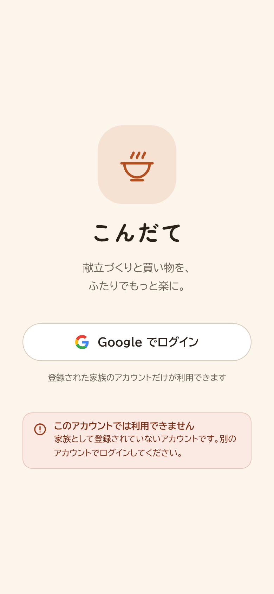
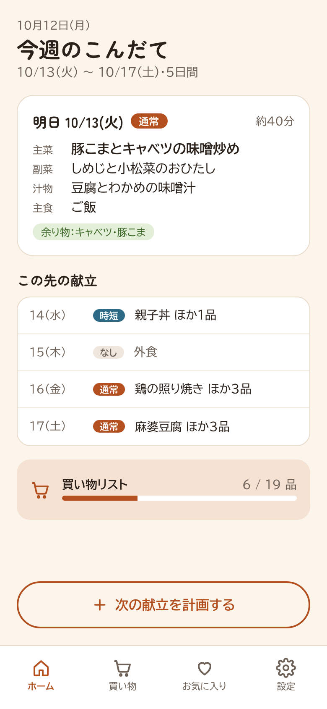
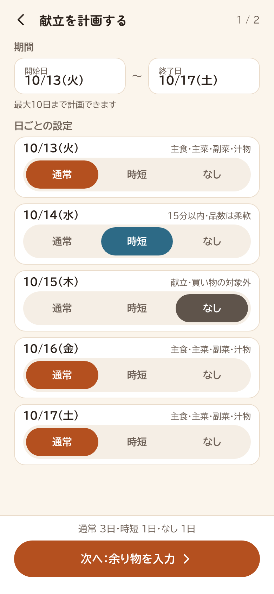
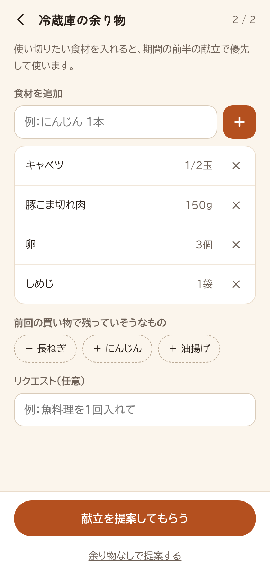
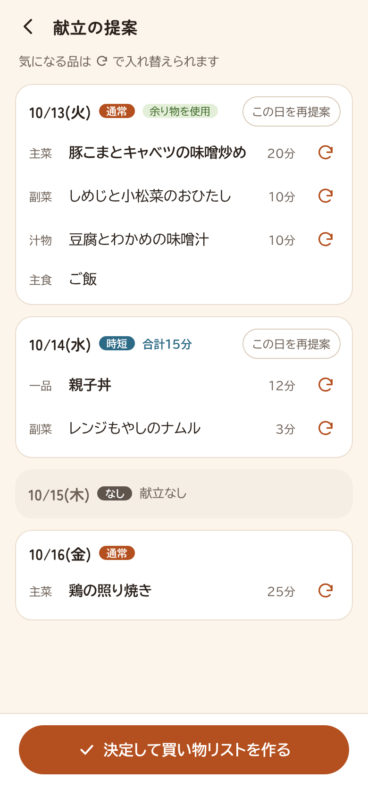
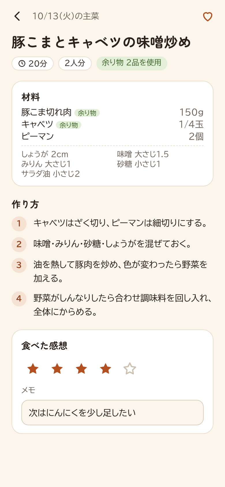
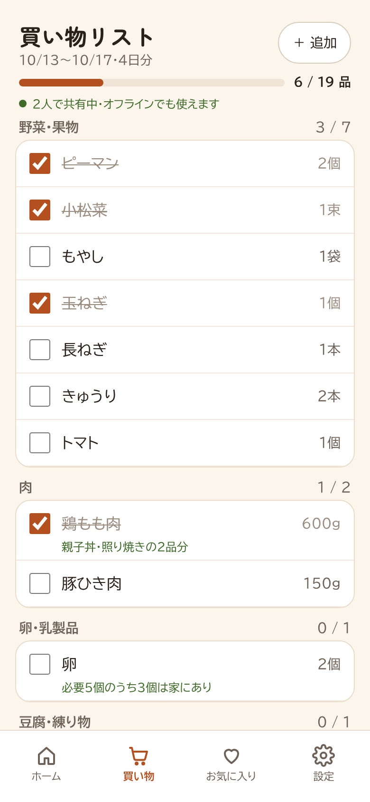
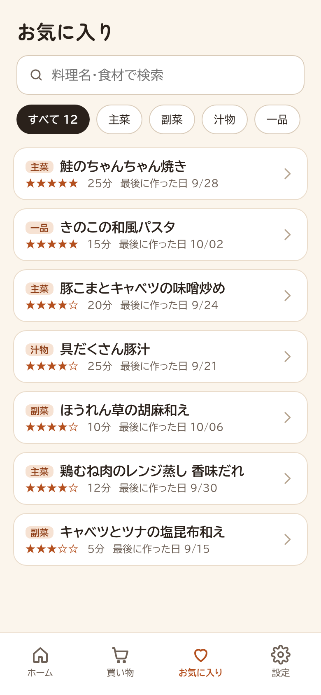
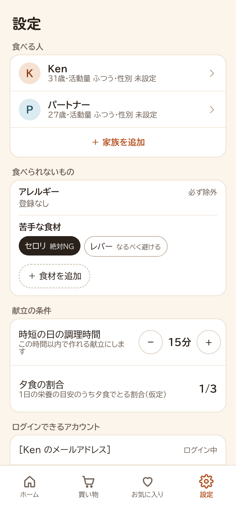

# kondate-app

家族2人で使う夕食の献立アプリ(スマホ向け PWA)。

## 解決したい課題

家族2人の夕食づくりで、次の負担を減らす。

| 課題                                           | アプリでの対応                                                                                                   |
| ---------------------------------------------- | ---------------------------------------------------------------------------------------------------------------- |
| 数日分の献立を考えるのが大変                   | 期間(最大10日)と日ごとの予定(通常 / 時短 / なし)を決めると Claude が献立を提案。気に入らない日・品だけ作り直せる |
| 冷蔵庫の余り物を使い切れない                   | 入力した余り物を、期間の前半の献立で優先して使う                                                                 |
| 品数の多い買い出しで、店内を行ったり来たりする | 期間中の食材を合算し、売り場順に並べた買い物リスト。2人でチェックを共有し、電波がなくても使える                  |
| 美味しかった献立を忘れてしまう                 | お気に入り・★評価・メモを残し、献立の差し替えに使える                                                            |
| 栄養バランスがわからない                       | 未対応(根拠付きの栄養アドバイスを今後追加)                                                                       |

ほかに、アレルギー・苦手な食材の除外(家族全員分)と献立の削除に対応。

## 画面

| S0 ログイン                             | S1 ホーム                              | S2 計画作成                                   |
| --------------------------------------- | -------------------------------------- | --------------------------------------------- |
|  |  |  |

| S3 余り物入力                               | S4 献立提案の確認                          | S5 料理詳細                                   |
| ------------------------------------------- | ------------------------------------------ | --------------------------------------------- |
|  |  |  |

| S6 買い物リスト                            | S7 お気に入り                               | S8 設定                                    |
| ------------------------------------------ | ------------------------------------------- | ------------------------------------------ |
|  |  |  |

画面デザイン(Claude Design)の画像。詳細は [docs/design/](docs/design/README.md)。

## ドキュメント

| ファイル                                                   | 内容                                        |
| ---------------------------------------------------------- | ------------------------------------------- |
| [docs/01_requirements.md](docs/01_requirements.md)         | 要件定義                                    |
| [docs/02_design.md](docs/02_design.md)                     | 設計(画面・データモデル・API・生成処理・UI) |
| [docs/design/](docs/design/README.md)                      | 画面デザイン(Claude Design)                 |
| [docs/03_tech_stack.md](docs/03_tech_stack.md)             | 技術選定                                    |
| [docs/04_model_evaluation.md](docs/04_model_evaluation.md) | 献立生成のモデル比較                        |

## 構成

```
apps/web/            React + Vite + TypeScript の PWA(Tailwind CSS, TanStack Query, React Router)
packages/plan-eval/  献立生成プロンプトのモデル比較ツール
supabase/
  migrations/        テーブル、RLS、権限、RPC
  functions/         Edge Functions: generate-plan(献立生成), regenerate(日・品の再提案)
  tests/database/    pgTAP テスト
.github/workflows/   CI と Supabase の keep-alive
```

## ローカル開発

必要なもの: Node.js 22、pnpm 10(`corepack enable`)、Docker

```bash
pnpm install
pnpm db:start                                   # Supabase を起動(初回は数分)
cp apps/web/.env.example apps/web/.env.local    # pnpm exec supabase status -o env の API_URL / ANON_KEY を記入
cp supabase/functions/.env.example supabase/functions/.env   # ANTHROPIC_API_KEY を記入

pnpm functions:serve   # ターミナル1: Edge Functions
pnpm dev               # ターミナル2: http://127.0.0.1:5173 (localhost ではなく 127.0.0.1 で開く)
```

ログインは画面下部の「開発用: メールでログイン」に `ken@example.com` か `partner@example.com` を入れ、
http://127.0.0.1:54324 に届いたメールのリンクを開く。マイグレーションを取り込んだら `pnpm db:reset`。

| コマンド                                     | 内容                                                         |
| -------------------------------------------- | ------------------------------------------------------------ |
| `pnpm lint` / `pnpm typecheck` / `pnpm test` | 静的解析・型チェック・単体テスト                             |
| `pnpm build`                                 | 本番ビルド                                                   |
| `pnpm db:reset`                              | マイグレーションと seed をやり直す(ローカルのデータは消える) |
| `pnpm db:test`                               | DB のテスト(RLS・権限・RPC)                                  |
| `pnpm db:types`                              | `apps/web/src/types/database.ts` を再生成                    |
| `pnpm eval:plan --dry-run`                   | モデル比較ツール(`packages/plan-eval/.env` に API キー)      |

## 本番環境

フロントエンドは Vercel、バックエンドは Supabase(無料プラン)。
`<ref>` は Supabase のプロジェクト ID、`<app>` は Vercel の URL(`https://<app>.vercel.app`)。

### 初回の準備

1. **Supabase**: プロジェクト作成時の Security は「Enable Data API」オン、「Automatically expose new tables」オフ、
   「Enable automatic RLS」オン(テーブルの権限はマイグレーションで付与する)

   ```bash
   pnpm exec supabase login
   pnpm exec supabase link --project-ref <ref>
   pnpm exec supabase db push
   pnpm exec supabase secrets set ANTHROPIC_API_KEY=<key>
   pnpm exec supabase functions deploy generate-plan
   pnpm exec supabase functions deploy regenerate
   ```

2. **Google ログイン**
   - Google Cloud: OAuth 同意画面(外部)で2人の Gmail をテストユーザーに追加。OAuth クライアント ID(ウェブアプリ)の
     リダイレクト URI は `https://<ref>.supabase.co/auth/v1/callback`
   - Supabase の Google プロバイダ: クライアント ID とシークレットを設定
   - Supabase の URL Configuration: Site URL `https://<app>.vercel.app`、Redirect URLs `https://<app>.vercel.app/auth/callback`
     (`https://` を付ける。末尾スラッシュなし)

3. **世帯と許可リスト**(SQL Editor。メールアドレスは Google ログインで返る表記と完全一致・小文字)

   ```sql
   with h as (insert into households (name) values ('うち') returning id),
        a as (insert into household_members (household_id, email, display_name)
              select id, x.email, x.name from h,
                (values ('<Ken の Gmail>', 'Ken'), ('<パートナーの Gmail>', 'パートナー')) as x(email, name)),
        m as (insert into members (household_id, name)
              select id, x.name from h, (values ('Ken'), ('パートナー')) as x(name))
   insert into household_settings (household_id) select id from h;
   ```

4. **Vercel**: GitHub のリポジトリを Import(ビルド設定は `vercel.json`)。環境変数は
   `VITE_SUPABASE_URL=https://<ref>.supabase.co`、`VITE_SUPABASE_ANON_KEY=<anon キー>`、`ENABLE_EXPERIMENTAL_COREPACK=1`

5. **GitHub**: Repository secrets に `SUPABASE_URL` と `SUPABASE_ANON_KEY`(keep-alive が週2回 DB に触れ、一時停止を防ぐ)

6. **スマホ**: iPhone は Safari の共有 →「ホーム画面に追加」、Android は Chrome のメニュー →「アプリをインストール」

### 更新のデプロイ

```bash
git push                                         # Vercel が自動でデプロイ
pnpm exec supabase db push                       # マイグレーションを追加したとき
pnpm exec supabase functions deploy <name>       # supabase/functions を変えたとき
```
