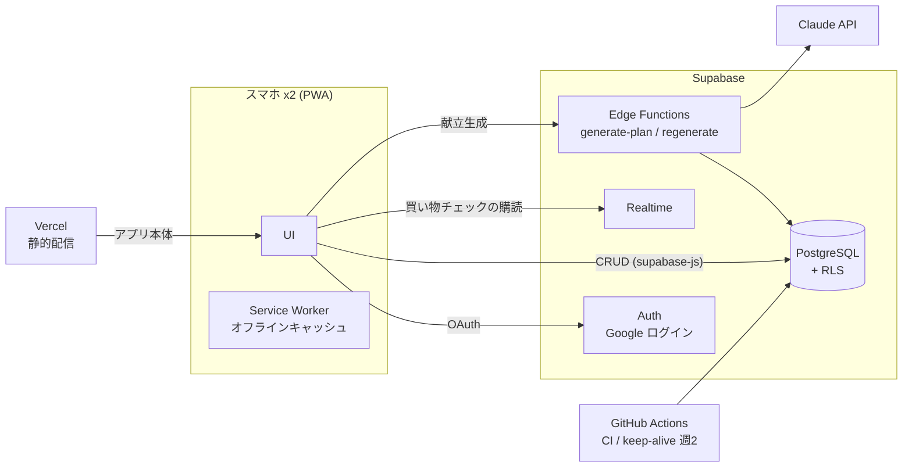
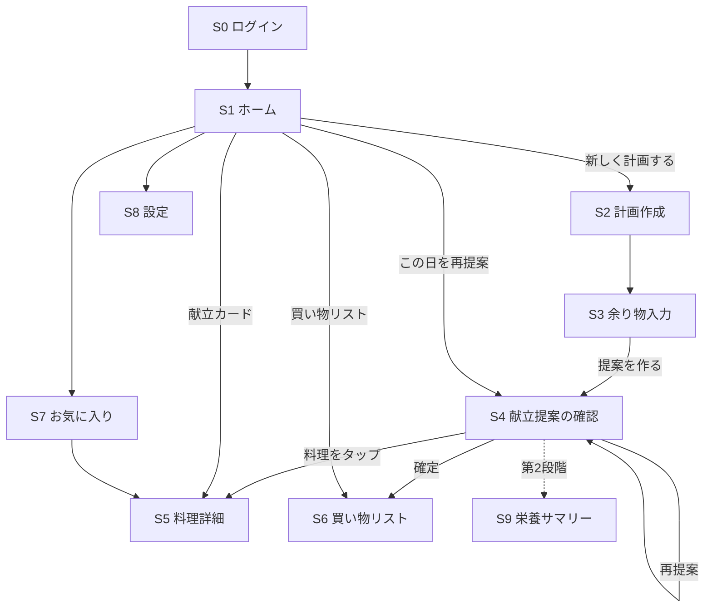
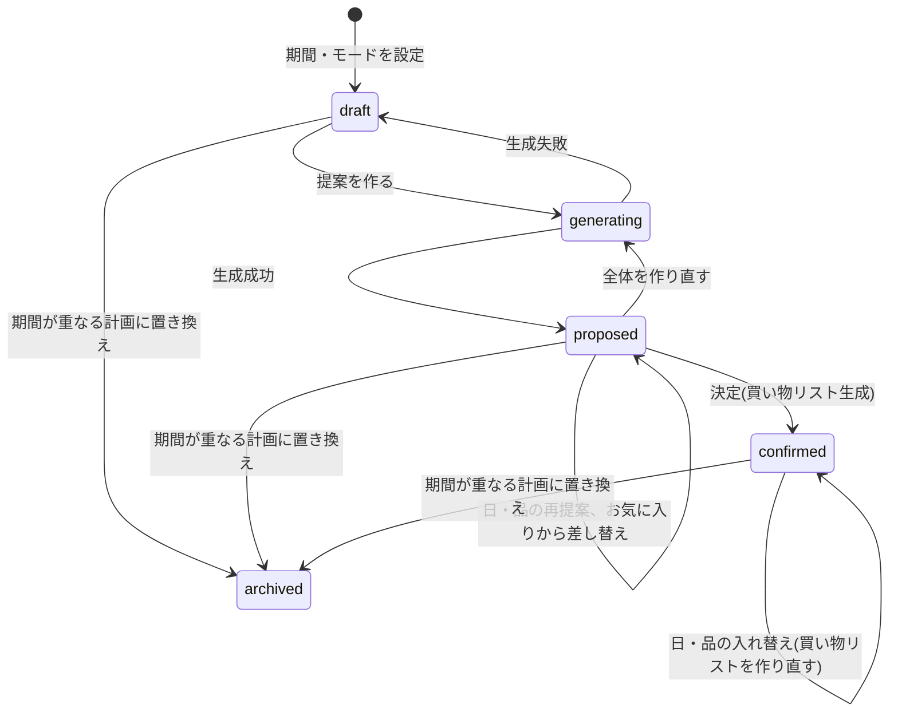
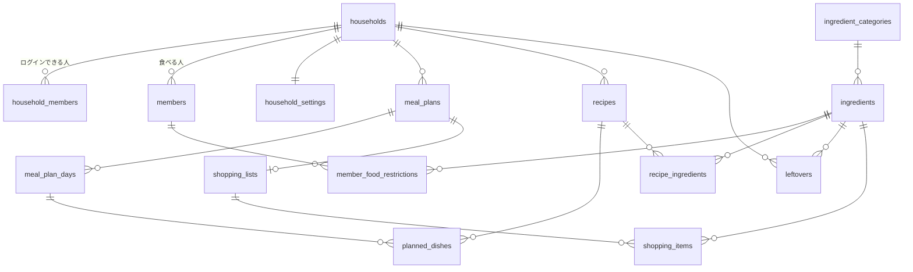
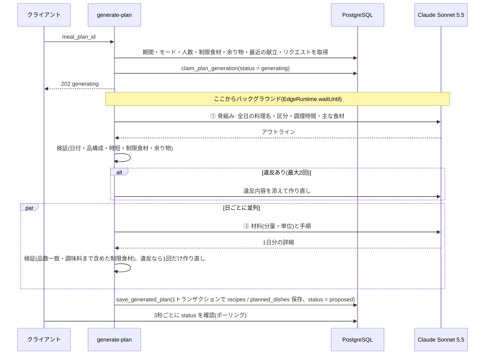

# 献立アプリ 設計書

| 項目 | 内容 |
|---|---|
| バージョン | v0.5 |
| 作成日 | 2026-10-12(更新 2026-10-18) |
| 前提 | [01_requirements.md](01_requirements.md) v0.5 |
| 状態 | 実装に合わせて更新済み |

---

## 1. システム構成



| 処理 | 実行場所 | 理由 |
|---|---|---|
| 単純な CRUD(設定、余り物、お気に入り、チェック) | クライアントから DB へ直接(RLS で保護) | API サーバー不要 |
| 献立生成・再提案 | Edge Function | LLM の API キーをクライアントに置かない |
| 買い物リスト生成 | クライアントで計算し、RPC で保存 | LLM を使わない決定的な計算。純粋関数として単体テストできる |
| 買い物チェックの同期 | Realtime(`shopping_items` の変更を購読) | 2人の端末に即時反映 |

フロントエンドは React + Vite の PWA([03_tech_stack.md](03_tech_stack.md))。

## 2. 画面設計

### 2.1 画面一覧

| ID | 画面 | 主な要素 | 対応機能 |
|---|---|---|---|
| S0 | ログイン | Google でログイン。許可リスト外は「利用できません」表示 | 認証 |
| S1 | ホーム | 今日(なければ次)の献立と日ごとのカード(「この日を再提案」)、買い物リストの進み具合、次の献立、「次の献立を計画する」 | ― |
| S2 | 計画作成 | 期間選択(開始日〜終了日、最大10日)、日ごとのモード切替(通常/時短/なし)、ほかの献立と期間が重なるときの警告 | F1a |
| S3 | 余り物入力 | 食材と量の入力(「にんじん 1本」)、未使用の余り物を引き継ぎ、リクエスト(自由入力)、献立の削除 | F2 |
| S4 | 献立提案の確認 | 日ごとの献立、品ごと・日ごとの再提案(希望を入力できるシート)、お気に入りから差し替え、作り置き(あとの日を選ぶシート。各日の同じ区分の料理と入れ替わる)、決定ボタン、全体を作り直す、献立の削除。作り置きの料理には「◯日に作ったもの・温め5分」、作る日には「3回分作る(◯日にも)」を表示 | F1, F1b, F8, F15 |
| S5 | 料理詳細 | 材料・分量、手順、調理時間、評価(★)・メモ、お気に入り登録。作り置きを作る日は材料を「1回分 / ◯回分」で切り替え、作り置きの日は作る日を表示 | F5, F15 |
| S6 | 買い物リスト | 売り場ごとのセクション、チェック(購入済みは取り消し線)、進み具合、手動追加・削除、作り直し、決定済みの献立が複数あるときの切り替え | F3, F4 |
| S7 | お気に入り | 保存済み料理の一覧(評価の高い順)、料理名・食材で検索、区分・15分以内で絞り込み | F5 |
| S8 | 設定 | 家族メンバー(名前・生年月日・性別・活動量)、食べられないもの(アレルギー / 絶対NG / なるべく避ける、誰が)、時短の上限時間(5〜60分)、夕食の比率(表示のみ)、ログインできるアカウント(表示のみ) | F13 |
| S9 | 栄養サマリー | 期間の栄養素と目標の比較、アドバイス(出典付き) | F6, F7(第2段階) |

### 2.2 画面遷移



ボトムナビゲーション: **ホーム / 買い物 / お気に入り / 設定**(片手操作を想定し下部に配置)

### 2.3 計画のステータス



- 期間が終わった計画は status を変えず、ホーム・買い物リストに出なくなるだけ(終了日が今日より前)
- 削除(`delete_meal_plan`)は `generating` 以外のどの状態からでもできる

## 3. データモデル

### 3.1 ER 図



### 3.2 テーブル定義

共通カラム(省略表記): `id uuid PK default gen_random_uuid()`, `created_at timestamptz`, `updated_at timestamptz`

**世帯・利用者**

| テーブル | カラム | 型 | 備考 |
|---|---|---|---|
| households | name | text | |
| household_members | household_id | uuid FK | |
| | email | text UNIQUE | **許可リスト**。auth.users の email と照合 |
| | display_name | text | |
| members | household_id | uuid FK | 食べる人 |
| | name | text | |
| | birth_date | date | 年齢は日付から算出(年齢区分が自動で変わる) |
| | sex | text null | `male` / `female` / null |
| | activity_level | text | `low` / `normal` / `high` |
| member_food_restrictions | member_id | uuid FK | |
| | ingredient_id | uuid FK null | マスタにない食材は `label` で保持 |
| | label | text | 表示名 |
| | kind | text | `allergy` / `never` / `avoid` |
| household_settings | household_id | uuid PK FK | |
| | quick_mode_max_minutes | int | 初期値 15 |
| | dinner_ratio | numeric | 初期値 0.33 |
| | category_order | uuid[] | 売り場順(F9 用。初期は既定順) |
| | budget_per_week | int null | 予算(現状未使用) |

**食材マスタ**

| テーブル | カラム | 型 | 備考 |
|---|---|---|---|
| ingredient_categories | name | text | 野菜・果物、肉、魚 … |
| | sort_order | int | 既定の売り場順 |
| ingredients | name | text UNIQUE | 正規名(例: 玉ねぎ) |
| | aliases | text[] | 表記ゆれ(たまねぎ、タマネギ) |
| | category_id | uuid FK | |
| | base_unit | text | 合算に使う単位(`g` / `ml` / `個` …) |
| | grams_per_piece | numeric null | 「1個 = 200g」などの換算 |
| | shelf_life_days | int null | 日持ち目安(前半に寄せる判定) |
| | food_composition_code | text null | 日本食品標準成分表の食品番号(栄養計算用) |

**レシピ・献立**

| テーブル | カラム | 型 | 備考 |
|---|---|---|---|
| recipes | household_id | uuid FK | LLM 生成もお気に入りも同じテーブル |
| | title | text | |
| | course | text | `staple`(主食)/ `main` / `side` / `soup` / `one_dish`(一品料理) |
| | cook_minutes | int | |
| | servings | int | 何人分の分量か |
| | steps | jsonb | 手順の配列 |
| | source | text | `llm` / `manual` / `url` |
| | is_favorite | bool | |
| | rating | int null | 1〜5 |
| | note | text | |
| recipe_ingredients | recipe_id | uuid FK | |
| | ingredient_id | uuid FK null | 正規化できなかった場合は null |
| | raw_name | text | LLM が出した元の名前 |
| | amount | numeric null | 「少々」は null |
| | unit | text | |
| | is_pantry | bool | 塩・醤油など常備品(買い物リストでは別枠) |
| meal_plans | household_id | uuid FK | |
| | start_date / end_date | date | CHECK: 期間は最大10日 |
| | status | text | `draft` / `generating` / `proposed` / `confirmed` / `archived` |
| | request | text | S3 のリクエスト(自由入力) |
| | generation_started_at / generation_error / generation_meta | timestamptz / text / jsonb | 生成の開始時刻、失敗理由、モデル・トークン数・警告 |
| meal_plan_days | meal_plan_id | uuid FK | |
| | date | date | UNIQUE(meal_plan_id, date, meal_type) |
| | meal_type | text | 当面は `dinner` のみ |
| | mode | text | `normal` / `quick` / `none` |
| planned_dishes | meal_plan_day_id | uuid FK | |
| | recipe_id | uuid FK | |
| | course | text | |
| | position | int | 表示順 |
| | made_on | uuid FK null | 作り置きなら、作る日の planned_dishes.id(recipe_id も同じ)。作る日の料理が消えると null(その日に作る料理になる) |
| leftovers | household_id | uuid FK | |
| | ingredient_id | uuid FK null | |
| | raw_name | text | |
| | amount / unit | numeric / text | 任意 |
| | used_in_plan_id | uuid FK null | どの計画で使ったか |

**買い物リスト**

| テーブル | カラム | 型 | 備考 |
|---|---|---|---|
| shopping_lists | meal_plan_id | uuid FK UNIQUE | 1計画に1リスト |
| shopping_items | shopping_list_id | uuid FK | |
| | ingredient_id | uuid FK null | |
| | display_name | text | |
| | category_id | uuid FK | |
| | amount / unit | numeric / text | 合算後 |
| | is_pantry | bool | 「家にあるか確認」セクション |
| | is_manual | bool | 手動追加(洗剤など) |
| | checked | bool | **Realtime 同期の対象** |
| | checked_by | uuid null | auth.users.id |
| | checked_at | timestamptz null | |
| | item_key | text null | 作り直してもチェックを引き継ぐためのキー(6章)。手動追加は null |

### 3.3 RLS(行レベルセキュリティ)

ログイン中ユーザーの世帯 ID を返す関数を1つ用意し、全テーブルで使う。

```sql
create function public.my_household_id() returns uuid
language sql stable security definer set search_path = public as $$
  select household_id from household_members
  where email = auth.jwt() ->> 'email'
$$;

-- 例: household_id を直接持つテーブル
alter table meal_plans enable row level security;
create policy "household access" on meal_plans
  for all using (household_id = my_household_id())
  with check (household_id = my_household_id());

-- 例: 親テーブル経由のテーブル
create policy "household access" on meal_plan_days
  for all using (
    exists (select 1 from meal_plans p
            where p.id = meal_plan_id and p.household_id = my_household_id())
  );
```

- 許可リスト外のユーザーはログインできても `my_household_id()` が null になり、**どのデータも見えない**。フロントでは S0 に「利用できません」を表示する
- `ingredients` / `ingredient_categories` はマスタなので、認証済みユーザーは読み取りのみ可
- テーブルの権限は RLS とは別に明示して付与する(`20261013000700_data_api_grants.sql`)。`anon` は売り場一覧の読み取り(keep-alive 用)以外は何もできず、`authenticated` にはアプリが行う操作だけを許可する。新しいテーブルはマイグレーションで権限を付けるまで公開されない

## 4. API 設計

### 4.1 クライアントから直接操作するもの(supabase-js + RLS)

| リソース | 操作 |
|---|---|
| members, member_food_restrictions, household_settings | CRUD(S8)。制限は `(member_id, label)` で upsert し、食材マスタの名前・別名に一致すれば `ingredient_id` を付ける(献立生成で表記ゆれも判定するため)。画面では同じ食材を1つにまとめ、家族のうち最も厳しい種類で表示する |
| meal_plans, meal_plan_days | `save_plan_draft` RPC で期間と日ごとのモードを1トランザクションで作成・変更。決定(status = confirmed) |
| (期間の重なり) | **1つの日付に献立は1つ**。`save_plan_draft` の最後に `claim_plan_dates` を呼び、期間が重なるほかの計画を、新しい計画より前に始まるものは前日までに短縮(以降の日は削除)、期間内に始まるものは `archived` にする。S2 は保存前に影響を表示し、1つの計画の中に収まるときは「その日だけ作り直す」(S4 の再提案)を案内する。短縮された決定済みの計画は買い物リストを作り直す |
| (削除) | `delete_meal_plan` RPC。日・料理・買い物リストはまとめて削除(on delete cascade)、使った余り物は未使用に戻し、お気に入り・評価のない LLM レシピは削除。生成中は不可。S4・S3 の「この献立を削除」(2回押しで確定)から。端末のキャッシュに残る買い物リストと、オフライン中の未送信チェックも破棄する |
| leftovers | CRUD |
| recipes | お気に入り・評価・メモの更新、手動登録 |
| planned_dishes | `swap_planned_dish` RPC でお気に入りの料理に差し替え(提案中・決定済みの計画)。作る日の料理を差し替えると作り置きも同じ料理に変わり、作り置きを差し替えるとその日に作る料理になる |
| (作り置き) | `make_ahead(p_source_dish, p_targets)` RPC。`p_targets` は `[{day_id, replace_dish_id}]`(`replace_dish_id` が null なら追加)。同じ計画のあとの日(`none` 以外)だけ、1品につき最大2日、作り置きの作り置きは不可(違反は 22023)。入れ替えた料理の LLM レシピは、お気に入り・評価がなければ削除し、その料理の警告も消す。決定済みの計画は買い物リストを作り直す |
| shopping_lists, shopping_items | `replace_shopping_list` RPC でリストを保存(6章)。`checked` の更新、手動追加・削除 |

### 4.2 Edge Functions

| メソッド | パス | 内容 |
|---|---|---|
| POST | `/functions/v1/generate-plan` | 計画全体の献立を生成 |
| POST | `/functions/v1/regenerate` | 指定した日または品を再提案 |

買い物リストは LLM を使わない決定的な計算なので、Edge Function ではなくクライアントで作る(6章)。

**generate-plan**(非同期。生成は1分前後かかるため、受付だけ返してバックグラウンドで実行)

```jsonc
// Request
{ "meal_plan_id": "uuid" }

// Response 202
{ "meal_plan_id": "uuid", "status": "generating" }
```

| ステータス | 意味 |
|---|---|
| 400 / 401 / 404 | 不正な ID / 未ログイン / 見つからない(他の世帯の計画も 404) |
| 409 `ALREADY_GENERATING` | 生成中、または確定済み |
| 422 `NO_DAYS` | 献立を作る日がない(全日「なし」) |

クライアントは `status` が `generating` の間、3秒ごとに計画を再取得し(TanStack Query の refetchInterval)、`proposed` になったら S4 に献立を表示する。生成は1分前後で終わるため、Realtime よりも単純なポーリングにした。
失敗時は `status = draft` に戻り、`generation_error` に画面表示用のメッセージが入る。
警告(苦手食材、傷みやすい食材が後半、など)は `generation_meta.warnings` に入る。

**regenerate**(同期。1日分か1品だけなので 20〜40 秒で終わり、保存してから応答する)

```jsonc
// 日ごと
{ "meal_plan_day_id": "uuid", "hint": "魚以外で" }
// 品ごと
{ "meal_plan_day_id": "uuid", "planned_dish_id": "uuid", "hint": "もっとさっぱり" }

// Response 200
{ "meal_plan_id": "uuid", "status": "proposed", "dishes": ["鶏肉とれんこんの甘酢炒め"] }
```

| ステータス | 意味 |
|---|---|
| 400 / 401 / 404 | 不正な ID / 未ログイン / 見つからない |
| 409 `NOT_CHANGEABLE` | 計画が `proposed` / `confirmed` 以外(生成中など) |
| 422 `NO_DINNER` / `REGENERATE_FAILED` | 献立なしの日 / 検証を通る案を作れなかった(メッセージに理由) |

- `proposed` と `confirmed` の計画で使える。`confirmed` の場合、クライアントは続けて買い物リストを作り直す(チェックは残る)
- お気に入りからの差し替えは LLM を使わないので `swap_planned_dish` RPC で直接行う


エラー形式(共通):

```json
{ "error": { "code": "LLM_TIMEOUT", "message": "献立の生成に時間がかかりすぎました。もう一度お試しください。" } }
```

## 5. 献立生成の処理

実装: `supabase/functions/_shared/plan/`(Edge Function とモデル比較ツール `packages/plan-eval` で共有)。
モデル比較の結果と2段階生成にした理由は [04_model_evaluation.md](04_model_evaluation.md)。



### 5.1 LLM への入力

| 入力 | 内容 |
|---|---|
| 日ごとの枠 | 日付とモード(`none` の日も日数を数えるために渡し、出力させない) |
| 構成ルール | `normal`: 主食+主菜+副菜+汁物 / `quick`: 合計 `quick_mode_max_minutes` 分以内、品数は柔軟 |
| 余り物 | `leftovers` のうち未使用のもの。期間の前半で使い切るよう指示 |
| 制限食材 | 家族全員分をまとめ、同じ食材は厳しい方(allergy > never > avoid)を採用 |
| 人数 | `members` の人数 |
| 最近の献立 | 直近14日の料理名(主食を除く) |
| リクエスト | `meal_plans.request`(S3 の自由入力) |

主なプロンプトの方針: 生の魚介・ひき肉・葉物は期間の1〜3日目、主菜のたんぱく源と調理法を連続させない、
米は1人0.5合で常備品扱い、調味料は `is_pantry = true`。

### 5.2 出力スキーマ

Claude の structured outputs(`output_config.format`)で、スキーマに適合した JSON を受け取る。

| 段階 | スキーマ | 内容 |
|---|---|---|
| ① 骨組み | `OUTLINE_SCHEMA` | `days[].dishes[]`: title / course / cook_minutes / main_ingredients / uses_leftovers |
| ② 詳細 | `DAY_DETAIL_SCHEMA` | `dishes[]`: title / ingredients(name, amount, unit, is_pantry)/ steps |

### 5.3 検証ルール

| チェック | 段階 | 結果 |
|---|---|---|
| 日付が計画と一致し、`none` の日を含まない・重複しない | ① | 違反 → 作り直し |
| `normal` の日に主食・主菜・副菜・汁物がある(一品料理は主食+主菜を兼ねる) | ① | 違反 → 作り直し |
| `quick` の日の調理時間の合計が上限以下 | ① | 違反 → 作り直し |
| `allergy` / `never` の食材(表記ゆれ・アレルゲンの隠れた原材料を含む) | ①② | 違反 → 作り直し |
| ②の品数が①と一致 | ② | 違反 → 作り直し |
| `avoid` の食材 | ①② | 警告 |
| 余り物が使われていない / 期間の後半で初めて使う | ① | 警告 |
| 期間内で同じ料理 / 直近14日と同じ料理 | ① | 警告 |
| 生の魚介・ひき肉を期間の4日目以降に使う | ② | 警告 |

作り置きの料理(`made_ahead`)は、時短の日の合計では温めの5分(`REHEAT_MINUTES`)と数え、同じ料理・制限食材・傷みやすい食材の確認からは外す(作る日に確認済み)。

### 5.4 日・品ごとの再提案

実装: `supabase/functions/_shared/plan/regenerate.ts`、保存は `replace_planned_dishes` RPC。

1. 計画全体の今の献立(料理名・主な食材)を読み、作り直す日・品以外は固定の文脈としてモデルに渡す
2. 骨組み(`DISHES_OUTLINE_SCHEMA`): 1品なら代わりの1品、日ごとならその日の全品。ヒント(`hint`)を最優先
3. 検証: 新しい品を入れたその日を、計画全体と同じルール(5.3)で検証し、その日と新しい品に関する指摘だけを使う。加えて
   - 1品の作り直しで、通常の日は区分を変えない(`COURSE_MISMATCH`)
   - 作り直す前と同じ料理は不可(`SAME_AS_BEFORE`)
   - 時短の日の時間上限は、残す品の時間も含めて判定する
4. 新しい品だけ材料と手順を作り、調味料まで含めて制限食材を確認する
5. その日の警告を新しいものに置き換えて保存。置き換えた LLM のレシピは、お気に入り・評価がなければ削除する
6. 余り物は「まだどの計画にも使っていないもの」だけを渡す(期間全体で使い切る判定はしない)
7. 作り置き(F15)
   - 日ごとの作り直しでは、その日の作り置きの料理は残し(`keepDishes`)、ほかの料理だけを作り直す。作り置きしかない日は作り直せない
   - 作り置きのある料理(作る日)を作り直すときは、どの日にも食べるかをモデルに伝え(`madeAheadFor`)、日持ちして温め直せる料理にする。保存時、作り置きは同じ区分の新しい料理につなぎ直す(同じ区分がなければ、その日に作る料理になる)
   - 作り置きの料理を1品だけ作り直すと、その日に作る料理になる(「作り置きをやめる」)

### 5.5 時間とコストの制約

- Supabase 無料枠の Edge Function は wall clock 150 秒。一括生成では最大 66 秒かかったため2段階に分けた
- 生成が途中で止まった場合に備え、`generating` のまま 3 分以上たった計画は再度 claim できる
- 1回の生成コストは Sonnet 5.5 の2段階生成で約 $0.13(月6回で約120円。[04_model_evaluation.md](04_model_evaluation.md) 5章)。再提案は1日分・1品分だけなので、これより小さい

## 6. 買い物リスト生成

実装: 計算は `apps/web/src/lib/shopping.ts`(純粋関数、単体テストあり)、保存は `replace_shopping_list` RPC。
S4 で「決定して買い物リストを作る」を押すと、計画を確定してからリストを作り、S6 に移る。

```
1. 計画の planned_dishes から recipe_ingredients を集める(mode = none の日は対象外)。
   作り置きも1行の planned_dishes なので、食べる回数分の材料が自動で入る
2. ingredient_id ごとにまとめる(マスタにない食材は表記を正規化した名前ごと)
3. 単位をそろえる: 表記ゆれ(グラム→g など)、kg→g、L→ml、大さじ・小さじ・カップ→ml、
   grams_per_piece があれば g→個(例: 玉ねぎ 1個 + 100g → 「1と1/2個」)
   換算できない組み合わせは行を分けて表示
4. 丸める: 個数は 1/4 単位で切り上げ、g・ml は 10 単位で切り上げ
5. 余り物を差し引く(「必要5個のうち3個は家にあり」と注記。量が不明なら「余り物が家にあるかも」)
6. is_pantry の食材は量を出さず「常備品(家にあるか確認)」セクションの最後へ
7. category の売り場順で並べる。マスタにない食材はキーワードで売り場を推定し、
   分からなければ「野菜・果物」
8. 複数の料理で使う食材には「親子丼・スープの2品分」と注記
```

- 対象は計画期間の全日(今日より前の日も含む)。期間の初日の前にまとめて買う前提
- 買い物タブには、決定済みで終了日が今日以降の計画のリストを出す

**保存(`replace_shopping_list(p_plan_id, p_items)`)**

- `status = confirmed` の計画だけ(それ以外は P0002)。1計画に1リスト
- 各行に安定したキー `item_key`(`i:<食材ID>` / `n:<正規化した名前>`)を持たせ、`(shopping_list_id, item_key)` で upsert する
- 献立を直して作り直しても、**同じキーの行は `checked` を維持**し、量や注記だけ更新する
- 不要になった行は削除する。手動で追加した行(`is_manual`、キーなし)は残す

## 7. 同期とオフライン

| 項目 | 方式 |
|---|---|
| チェックの同期 | Supabase Realtime で `shopping_items` を購読し、変更があればリストを再取得 |
| 同時編集 | `checked` は1項目1値なので後勝ちで十分 |
| 画面の読み込み | Service Worker(vite-plugin-pwa)がアプリ本体をキャッシュし、電波がなくても起動 |
| オフライン表示 | TanStack Query のキャッシュを localStorage に保存(`kondate-cache`、7日間)。電波がなくても最後に取得したリストを表示 |
| オフライン中のチェック | 画面はすぐ更新し(楽観的更新)、送信は一時停止して保存。オンラインに戻るか、アプリを開き直したときに送信(失敗時は3回まで再試行) |
| 起動時の状態 | TanStack Query は起動時に「オンライン」と仮定するため、`navigator.onLine` で初期化する |
| ログアウト | キャッシュを消す |

## 8. 運用

| 項目 | 内容 |
|---|---|
| keep-alive | GitHub Actions で週2回、軽い SELECT を実行(Supabase 無料枠の一時停止を防ぐ) |
| バックアップ | 無料枠には自動バックアップがない。月1回 `pg_dump` を取る仕組みは**未実装** |
| シークレット | LLM の API キーは Edge Function の環境変数にのみ保存 |
| 食材マスタ | 本番は**未投入**(seed はローカル開発用)。マスタにない食材は、買い物リストでは売り場をキーワードで推定し、制限食材の照合は表記ゆれを正規化して行う |
| デプロイ | `main` への push で Vercel が自動デプロイ。マイグレーションと Edge Functions は Supabase CLI で手動適用 |

## 9. 画面デザイン(確定)

デザインは Claude Design のキャンバス「献立アプリ 画面デザイン」で確定した(2026-10-12)。

- キャンバス: https://claude.ai/artifact/Tue2LqTgeJ4Rx1r3qcKC5P (非公開。オーナーのみ閲覧可)
- 画面: S0〜S8 の9画面、スマホ 390×844 基準。画像と元データは [design/](design/README.md) に保存

### 9.1 デザイントークン

| トークン | 値 | 用途 |
|---|---|---|
| `bg` | `#FBF5EC` | 画面背景(生成り) |
| `surface` | `#FFFFFF` | カード |
| `border` | `#EADCCB` | カードの枠線 |
| `divider` | `#F1E7DA` | リスト内の区切り線 |
| `ink` | `#2A211B` | 本文 |
| `muted` | `#6E6157` | 補足テキスト |
| `primary` | `#B4501F` | 差し色(柿色)、主ボタン、`通常` モード |
| `primary-strong` | `#8E3E17` | ホバー、濃い文字 |
| `primary-soft` | `#F6E2D3` | 柿色の淡い背景 |
| `quick` | `#2D6A86` | `時短` モード |
| `none` | `#5F544B` | `なし` モード |
| `leftover` / `leftover-soft` | `#3F6A2A` / `#E4EFD9` | 余り物タグ |

| 用途 | フォント |
|---|---|
| 見出し | Zen Maru Gothic (500 / 700) |
| 本文 | BIZ UDPGothic (400 / 700) |

### 9.2 UI ルール

- タップ領域は 44px 以上。メインメニューは画面下部(ホーム / 買い物 / お気に入り / 設定)
- モードは色に加えて文字ラベルで区別する(色覚に依存しない)
- 主ボタンは角丸ピル型、高さ 52px

## 10. 未決事項

| 項目 | 決めるフェーズ |
|---|---|
| 食材マスタの初期データの作り方(成分表から抽出 or 手作業) | 第2段階(栄養機能と合わせて) |
| 栄養計算(F6, F7)の詳細設計 | 第2段階 |
| お気に入りを提案に一定割合で混ぜる(F8 の残り) | 未定 |
| DB のバックアップ | 未定 |
